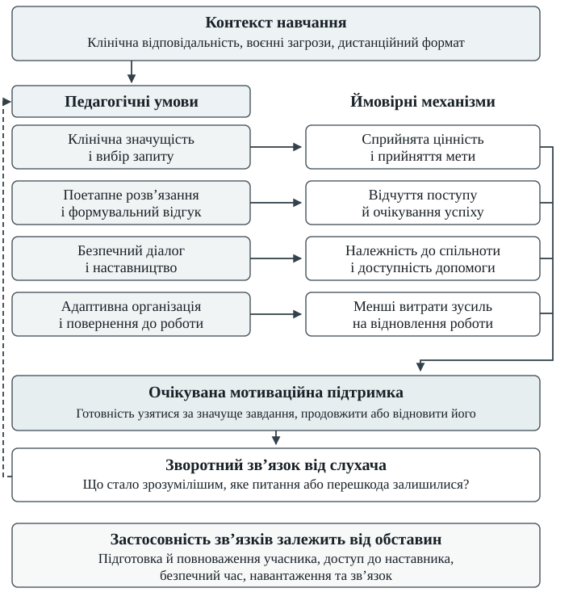

# РОЗДІЛ 2
# ПЕДАГОГІЧНІ УМОВИ ПІДТРИМКИ НАВЧАЛЬНОЇ МОТИВАЦІЇ ЗДОБУВАЧІВ МЕДИЧНОЇ ОСВІТИ

## 2.1. Педагогічні умови як категорія педагогічної науки

Поняття педагогічних умов дозволяє перейти від пояснення навчальної мотивації до проєктування освітнього процесу, здатного її підтримувати. У межах цієї роботи воно стосується цілеспрямованої організації змісту, діяльності та взаємодії з урахуванням можливостей здобувачів. Результати першого розділу показують потребу пов’язувати такі рішення з професійною значущістю навчання, характером мотиваційної регуляції та доступними ресурсами. Водночас обґрунтування умов потребує уточнення їхнього поняттєвого статусу: назва певного цифрового засобу або бажаного результату ще не пояснює, яку характеристику освітнього процесу слід забезпечити.

У практичному посібнику А. Литвина педагогічні умови розглянуто як спеціально спроєктовані системотвірні чинники впливу на обставини освітнього процесу та параметри його учасників. Автор пов’язує їх із цілісністю освітньої системи й цілеспрямованими процедурами її організації [2, с. 75–76]. Для цього дослідження істотними є проєктований характер умов і взаємозв’язок їхнього змісту. Водночас положення про гарантовану якість результатів потребують співвіднесення з дослідницьким дизайном. У теоретичній роботі можна обґрунтувати доцільність певної організації навчання, тоді як висновок про її фактичний вплив потребуватиме окремої перевірки.

Розмежування суміжних понять у цій роботі має функціональний характер. Чинником називатимемо обставину, властивість або вплив, важливі для перебігу навчання; вони можуть бути як сприятливими, так і обмежувальними та мати різний ступінь керованості. Педагогічна умова позначатиме характеристику організації освітнього процесу, яку можна цілеспрямовано забезпечувати у відповідь на визначену потребу. Наприклад, перебої зв’язку є контекстним обмеженням, а організація доступного повернення до перерваного завдання — можливим педагогічним рішенням. Таке розмежування конкретизує дослідницьку логіку, враховуючи, що у визначенні А. Литвина поняття умов і чинників взаємопов’язані [2, с. 75].

Принципом для подальшого аналізу вважатимемо загальний орієнтир побудови навчання, методом — спосіб організації навчальної діяльності, а інструментом — засіб виконання певної дії. Умова характеризує організацію процесу, в якій ці способи й засоби набувають педагогічного змісту. Зокрема, аналіз клінічної ситуації є методом, цифрова платформа може бути інструментом, а узгодження завдань з актуальними професійними потребами — характеристикою організації змісту. Бажаний результат, як-от готовність продовжувати самоосвіту, слід відокремлювати від способів його підтримки. Ці робочі розрізнення потрібні для послідовного опису моделі й не претендують на вичерпну класифікацію педагогічних категорій.

Відповідно, педагогічними умовами підтримки навчальної мотивації здобувачів медичної освіти вважатимемо взаємопов’язані характеристики змісту, організації та освітньої взаємодії, які цілеспрямовано проєктують з урахуванням контекстних обмежень для створення можливостей усвідомленої й посильної навчальної діяльності. Це авторське робоче визначення конкретизує предмет дослідження. Воно зосереджує увагу на тому, що можуть організувати учасники освітнього процесу, та передбачає пояснення мотиваційного механізму кожного рішення. Очікуваний ефект при цьому формулюється як теоретично вмотивоване припущення.

Наприклад, у дистанційному навчанні клінічне обговорення може бути перерване через повітряну тривогу або втрату зв’язку — подібні труднощі описано в українському дослідженні потреб медичних закладів [15]. Саме переривання не визначає ставлення слухача до матеріалу. Педагогічна відповідь може полягати у збереженні навчального запитання, можливості пізніше подати обґрунтування та отримати пояснення. У цьому прикладі організаційна доступність створює можливість продовження роботи, а змістовний відгук потенційно підтримує відчуття компетентності. Останній зв’язок спирається на теорію самодетермінації [18]; його реалізація в конкретній групі залишається предметом майбутнього дослідження.

Для побудови системи умов важливий прозорий дизайн концептуального дослідження. У методологічній статті Е. Яакколи, присвяченій концептуальним працям у маркетингу, обґрунтовано потребу пояснювати добір теорій, їхні ролі та логіку формування аргументів. Модельний підхід передбачає розкриття зв’язків між поняттями й механізмів передбачуваного впливу [7]. Для цієї роботи зазначені положення є методологічним орієнтиром побудови пояснення, а не предметним джерелом про медичну освіту. Відповідно, модель має показувати, чому певна організація навчання потенційно підтримує визначений компонент мотивації та за яких обмежень цей зв’язок може послаблюватися.

Процедура теоретичного моделювання в дослідженні передбачає послідовне зіставлення джерельних положень, контекстних ризиків і педагогічних можливостей. Теорія самодетермінації використовується для пояснення якості регуляції та підтримки автономії, компетентності й пов’язаності. Положення про очікування та цінність допомагають аналізувати значущість завдання, його сприйняту досяжність і витрати, а моделі саморегуляції — планування й підтримання навчальних дій [4; 16; 18]. Вибір цих підходів зумовлений взаємодоповнювальністю їхніх пояснень щодо предмета роботи. Їхні поняття зберігають власний зміст і співвідносяться через конкретне педагогічне завдання.

Наступним кроком є зіставлення таких механізмів із ризиками, описаними в літературі про дистанційне навчання й воєнний контекст. При цьому враховуються контингент, спосіб отримання результату та межі його перенесення. Із цього зіставлення мають випливати формулювання умов, спрямованих на педагогічно доступні зміни. Для кожної умови потрібно визначити зміст організаційного рішення, механізм мотиваційної підтримки, можливі інструменти, очікуваний ефект і обмеження застосування. Споріднені рішення об’єднуються за спільним механізмом або функцією, зі збереженням пояснення внеску кожного складника. Така процедура є авторською конкретизацією логіки концептуального дослідження [7].

Внутрішня узгодженість моделі перевіряється через відповідність між виявленою проблемою, запропонованою умовою й пояснювальним механізмом. Зокрема, слід з’ясувати, чи стосується очікувана зміна саме мотивації, чи лише доступу або задоволеності; чи не дублюються умови; чи узгоджуються вони між собою та з можливостями викладача і здобувача. Окремого розгляду потребують ситуації, у яких педагогічне рішення виявиться недостатнім через зовнішні обмеження. Це критерії концептуального аналізу запропонованої побудови. Вони дозволяють уточнити аргументацію, однак не встановлюють величини або наявності фактичного ефекту.

А. Литвин поряд із теоретичним розглядом описує факторний аналіз та експериментальні способи обґрунтування умов [2, с. 56–58]. У цій роботі обрано теоретичний дизайн без власного емпіричного етапу. Тому аналіз зв’язків між положеннями не слід трактувати як статистичне виокремлення чинників, експертну валідацію або перевірку необхідності й достатності системи. Результатом має стати концептуальна модель із відкрито сформульованими передумовами та межами. Подальша систематизація ризиків потрібна для того, щоб наповнити цю методологічну логіку конкретним змістом медичної освіти в умовах дистанційного навчання під час війни.

## 2.2. Чинники ризику зниження навчальної мотивації в умовах дистанційного навчання та воєнного часу

Чинники ризику в цій роботі розглядаються як обставини, що можуть ускладнювати підтримання навчальної мотивації або реалізацію вже сформованих намірів. Ці способи впливу потребують розмежування. В одному випадку змінюється сприйняття цінності, досяжності чи особистісного прийняття навчальної мети; в іншому — участь обмежується через нестачу часу, небезпеку або недоступність ресурсів. Запропонована систематизація має теоретичний характер: вона визначає можливі ланки впливу, не встановлюючи поширеності, питомої ваги або причинного ефекту окремих чинників.

Підставою для групування є поєднання мотиваційних теорій із результатами досліджень навчального середовища. Теоретичні положення допомагають пояснити, чому певна обставина може впливати на очікування успіху, сприйняті витрати, автономність регуляції чи відчуття компетентності [4; 18]. Українські дослідження та описи освітнього досвіду конкретизують обмеження воєнного часу [10; 12; 15; 17]. Співвіднесення цих джерел дозволяє виокремити психологічні, педагогічні, технологічні, соціальні й організаційні групи ризиків. Безпекові загрози перетинають ці групи та змінюють умови реалізації педагогічних рішень.

Психологічні ризики охоплюють переживання небезпеки, виснаження, труднощі концентрації й невпевненість у можливості впоратися з навчальним завданням. У дослідженні потреб українських медичних закладів та роботі про медичних аспірантів описано повідомлення учасників про страх, втому й ускладнення академічної діяльності [12; 15]. Такі дані засвідчують наявність відповідного досвіду в досліджених групах. Вони не дозволяють за окремим проявом поведінки встановлювати психологічний стан конкретного слухача або ототожнювати труднощі зосередження з утратою професійного інтересу.

Можливий мотиваційний механізм пов’язаний із тим, як здобувач оцінює власну спроможність і витрати подальшої роботи. Коли завдання сприймається як значуще, але недосяжне за наявних ресурсів, намір продовжувати може слабшати. Це теоретичне припущення спирається на положення про очікування та цінність [4]. Водночас усвідомлення прогалини в знаннях може бути підставою для змістовного навчального запиту. Тому невпевненість потребує аналізу разом із доступністю допомоги, характером завдання й попередньою підготовкою; сама по собі вона не характеризує мотивацію однозначно.

Педагогічні ризики стосуються невідповідності змісту професійним потребам, необґрунтованої складності, нечітких цілей і недостатнього пояснення навчального поступу. Для післядипломної освіти особливо важливим є зв’язок матеріалу з питаннями, які слухач може впізнати у власній практиці. Дослідження сімейних лікарів Данії показує значення актуального оновлення знань і тем, що становлять інтерес, серед мотивів участі в неперервній освіті [6]. Ці результати не описують українську систему БПР, але підтримують доцільність аналізу професійної релевантності. Теоретично її недостатня вираженість може обмежувати сприйняту цінність запропонованої роботи [4].

У різнорідній групі ризик виникає також тоді, коли однакове завдання передбачає підготовку або професійні повноваження, яких частина слухачів не має. Наприклад, потреби сімейного лікаря та фахівця, який поглиблено опановує онкологію, можуть відрізнятися щодо тієї самої теми. Це підстава для аналізу відповідності навчальних цілей, а не для попереднього оцінювання зацікавленості учасників. Надмірно складна робота може сприйматися як недосяжна, тоді як повторення вже опанованого матеріалу без пояснення його значущості — як малокорисне. Така інтерпретація випливає зі співвіднесення цінності завдання й очікування успіху [4].

Формальні освітні стимули слід розглядати окремо від ризику формалізації самого навчання. Прагнення отримати бали БПР може співіснувати з професійним інтересом та особисто прийнятою потребою вдосконалення [18]. Ризик у запропонованій аналітичній логіці пов’язаний із ситуацією, коли організація курсу спрямовує увагу переважно на технічне завершення вимог, залишаючи мало можливостей осмислити клінічне питання й отримати змістовну відповідь. Тому зовнішній мотив слухача не є достатньою підставою для висновку про якість його участі або особистісну зрілість.

Недостатній зворотний зв’язок може посилювати педагогічні труднощі, якщо здобувач не розуміє підстав оцінки та способу вдосконалити рішення. Метааналіз освітніх досліджень Б. Вісневського та співавторів показує неоднорідність ефектів відгуку й значення його інформаційного змісту; результати щодо мотивації відрізняються від когнітивних результатів [22]. Цей корпус не обмежений медичною освітою. Отже, він обґрунтовує увагу до змісту пояснення, але не доводить, що будь-який автоматичний коментар або позитивна оцінка підтримають мотивацію в конкретному дистанційному курсі.

Технологічні ризики передусім обмежують доступ до навчальних дій. Перебої електропостачання, нестабільний інтернет і вимушені переривання описано в українських дослідженнях [10; 15]. Їхній безпосередній наслідок може полягати в неможливості отримати матеріал, узяти участь в обговоренні або подати відповідь. Подальший вплив на мотивацію залежить від того, чи вдається відновити роботу й зберегти зрозумілу навчальну мету. Зокрема, нижчі оцінки сприйнятого здобутку за частих переривань в оцінюванні UA-MEDSAT не є прямим вимірюванням зниження мотивації [10].

Додаткового розгляду потребує організація роботи з цифровими ресурсами. Фрагментовані матеріали, неочевидна послідовність дій і розпорошені канали комунікації можуть збільшувати витрати на орієнтування в курсі. Це проєктно-теоретичний ризик, який випливає з вимоги узгоджувати цілі, взаємодію та підтримку в онлайн-навчанні [5]. Його слід відрізняти від зовнішньої недоступності інфраструктури. У першому випадку значна частина труднощів стосується педагогічної організації середовища, у другому можливості викладача безпосередньо змінити ситуацію обмежені.

Соціальні ризики охоплюють втрату звичних професійних контактів, брак колегіального обговорення й складність звернення по допомогу. Для самоспрямованого навчання медичних фахівців соціальні взаємодії та робоче середовище є важливими контекстами, що показує відповідний систематичний огляд [3]. У теорії самодетермінації значення підтримувальних відносин пояснюється через потребу в пов’язаності з іншими [18]. Для цієї роботи це дає підстави аналізувати доступність професійного діалогу, водночас ураховуючи різнорідність професій і дослідницьких дизайнів в оглянутому корпусі.

Переміщення та розділення родин можуть поєднувати соціальні труднощі з фінансовими й часовими обмеженнями [12; 15]. За таких обставин номінальна належність до онлайн-групи ще не характеризує можливість змістовно взаємодіяти. Наприклад, відсутність доступного способу поставити запитання може залишати навчальну проблему нерозв’язаною навіть за наявності всіх матеріалів. Водночас потреба в підтримці не означає однакової бажаної інтенсивності спілкування для всіх. Аналіз має враховувати характер професійного запиту й те, чи допомагає запропонована взаємодія його опрацювати.

Організаційні ризики пов’язані з конфліктом графіків, надмірним навантаженням, непередбачуваними змінами й відсутністю зрозумілого порядку продовження перерваної роботи. Для працюючого лікаря навчальне завдання співвідноситься з обов’язками перед пацієнтами та іншими професійними пріоритетами. Дефіцит часу й конкуруючі вимоги клінічного середовища описано в огляді самоосвіти медичних фахівців [3]. Тому невиконання в певний строк потребує з’ясування доступних можливостей. Воно може відображати організаційний конфлікт за збереженої цінності професійного розвитку.

Воєнні обставини ускладнюють планування також для викладачів. Українські публікації описують додаткове навантаження, перебудову графіків і потребу підтримувати комунікацію [15; 17]. У межах запропонованої систематизації ризиком є накопичення вимог без узгодження ресурсів їх виконання. Перенесення всього пропущеного матеріалу в додаткову самостійну роботу може зберегти формальний обсяг курсу, однак залишити невирішеними труднощі доступу й розуміння. Така ситуація потребує аналізу організації навчання поряд з оцінюванням індивідуальних зусиль.

У таблиці 2.1 узагальнено аналітичні групи й можливі ланки їхнього впливу. Наведені механізми є теоретичною інтерпретацією; вони не означають однакової реакції всіх здобувачів.

**Таблиця 2.1 — Аналітичне групування чинників ризику**

| Група | Основні прояви | Можлива ланка впливу | Джерела |
|---|---|---|---|
| Психологічні | Переживання небезпеки, виснаження, невпевненість | Ускладнення концентрації; зміна очікування успіху та сприйнятих витрат | [4; 12; 15] |
| Педагогічні | Нечіткі цілі, невідповідність змісту потребам і підготовці, малоінформативний відгук | Послаблення сприйнятої цінності та відчуття поступу | [4; 6; 18; 22] |
| Технологічні | Недоступність електрики, зв’язку або цифрових ресурсів | Обмеження участі; за повторних зривів — можливе ускладнення підтримання зусиль | [5; 10; 15] |
| Соціальні | Розрив звичних зв’язків, брак колегіального діалогу й допомоги | Зменшення доступної підтримки та відчуття належності | [3; 12; 15; 18] |
| Організаційні | Конфлікт графіків, перевантаження, непередбачувані вимоги | Конкуренція за час і сили; зниження сприйнятої досяжності навчальної мети | [3; 4; 15; 17] |

Наведені групи взаємодіють. Якщо через перебої доступу слухач пропускає пояснення, а подальша робота не передбачає зрозумілого способу повернення, технічна перешкода може поєднуватися з організаційною та педагогічною. Накопичення нерозв’язаних питань теоретично здатне впливати на оцінювання власної спроможності й готовність продовжувати. Такий можливий ланцюг взаємодій показує потребу аналізувати зв’язки між ризиками, зберігаючи відмінність між зовнішньою перешкодою та її ймовірним мотиваційним наслідком.

Межі застосовності систематизації визначаються також складом джерельної бази. Дані про українських студентів, медичних аспірантів і професійний розвиток лікарів в інших країнах стосуються різних освітніх ситуацій [6; 10; 12; 15]. Їх зіставлення допомагає визначити питання для педагогічного проєктування, проте не встановлює структури ризиків для всіх українських лікарів. Відвідування, завершення курсу, задоволеність і якість клінічного рішення при цьому залишаються різними характеристиками діяльності. Жодну з них окремо не слід використовувати як вичерпний показник мотивації [4; 18].

Запропоноване групування створює основу для обґрунтування педагогічних умов у наступному підрозділі. Кожне рішення має співвідноситися з конкретною проблемою, можливим механізмом підтримки та доступними ресурсами. Кількість груп ризиків не визначає кількості педагогічних умов: одна умова може стосуватися кількох взаємопов’язаних труднощів. Завдання подальшого моделювання полягає в поясненні таких зв’язків і меж педагогічного впливу з урахуванням професійних потреб, автономії та реальних можливостей здобувачів.

## 2.3. Обґрунтування сукупності педагогічних умов підтримки навчальної мотивації

Лікар, який обрав цикл тематичного удосконалення заради балів безперервного професійного розвитку (БПР), може прийти на заняття із запитанням, що давно потребує відповіді. І навпаки, слухач із виразним професійним інтересом може перервати розбір випадку через повітряну тривогу або терміновий виклик до пацієнта. Для викладача це дві різні педагогічні ситуації. У першій важливо допомогти людині побачити у програмі місце для власного запиту. У другій треба зберегти можливість повернутися до вже обраної мети. Саме тому в запропонованій моделі підтримка мотивації охоплює як формування особисто значущого наміру, так і створення умов, за яких здобувач може продовжувати осмислену роботу. Підстави для такого розмежування дають теорії мотиваційної регуляції та дослідження освітніх обмежень воєнного часу [4; 15; 18].

Одиницею моделювання обрано роботу здобувача над конкретною професійною проблемою. Такою проблемою може бути невизначеність під час первинного прийому, потреба перевірити застаріле знання або труднощі у взаємодії з колегою іншої спеціальності. На цьому рівні викладач може змінювати зміст завдання, спосіб його опрацювання, характер зворотного зв’язку та порядок відновлення заняття. Очікуваний внесок кожної зміни можна простежити через судження самого слухача про значущість завдання, власну спроможність і доступну допомогу. Такий спосіб побудови моделі спирається на системне розуміння педагогічних умов та на вимогу пояснювати зв’язки між поняттями в концептуальному дослідженні [2; 7].

Зіставлення ризиків, описаних у підрозділі 2.2, дало підстави виокремити чотири педагогічні умови. Клінічна значущість завдання з можливістю вибору визначає, заради чого здобувач береться до роботи. Поетапне розв’язання із формувальним зворотним зв’язком дає йому підстави судити про власний поступ. Психологічно безпечний професійний діалог відкриває можливість назвати сумнів і залучити досвід колег. Адаптивна організація навчання дає змогу реалізувати намір після вимушеної перерви. Поділ на чотири умови зумовлений різними функціями, доступними педагогічному впливу. Так, технічний збій і конфлікт графіків мають різне походження, проте можуть потребувати того самого рішення щодо повернення до заняття. Водночас докладний коментар до відповіді та готовність слухача відкрито обговорити цей коментар залежать від різних властивостей навчального середовища.

**Клінічна значущість завдання і можливість вибору професійного запиту.** Вихідною точкою для добору змісту є рішення, яке здобувач може впізнати як частину своєї теперішньої або майбутньої практики. У теоріях очікування та цінності важить те, яку користь бачить у роботі сама людина. Теорія самодетермінації дає інше, сумісне з цим пояснення. Навіть задана програмою мета може бути особисто прийнятою, якщо здобувач розуміє її професійний сенс [4; 18]. Наприклад, лікар може вважати перевірку клінічної настанови складною і водночас добровільно повернутися до неї, оскільки невизначеність стосується його пацієнтів. Для викладача це означає, що початковий інтерес до теми та готовність працювати над професійно важливим питанням варто розглядати окремо.

На циклі з онконастороженості умову можна реалізувати через короткий навчальний опис повторного звернення пацієнта, у якому попереднє пояснення скарг залишає відкриті питання. Сімейному лікарю пропонується визначити, яких даних бракує для обґрунтування наступного кроку. Лікар, який проходить спеціалізацію з онкології, може розглянути той самий випадок із позиції консультанта й пояснити, яка інформація у скеруванні допоможе відповісти колезі. Обидва працюють над спільною метою — обґрунтувати рішення за неповних даних. Вибір змінює професійну перспективу, з якої слухач опрацьовує матеріал. Завдяки цьому в різнорідній групі є підстава для подальшої розмови про те, як рішення одного лікаря впливає на роботу іншого.

Право вибору має педагогічний сенс, коли варіанти справді змінюють питання, спосіб аргументації або джерело, до якого звернеться слухач. Вибір часу відтворення однакової лекції розширює доступ, однак залишає відкритим питання про значущість її змісту. Викладач може заздалегідь задати спільний критерій якості рішення й запропонувати два професійно виправдані шляхи до нього. У данському дослідженні сімейних лікарів інтерес до теми та потреба оновити знання фігурували серед названих учасниками мотивів неперервної освіти [6]. Ці дані обґрунтовують увагу до запитів практиків. В українському дистанційному курсі очікуваним наслідком є готовність сформулювати власне питання навіть за початкової орієнтації на бали БПР. Межі вибору визначають обов’язкові результати підготовки й повноваження учасника. Для старшокурсника доречним завданням буде підготувати аргументоване запитання наставнику. Чим менше попереднього досвіду має здобувач, тим важливіше пояснити, на які ознаки ситуації він може спертися, обираючи завдання [13].

**Поетапне самостійне розв’язання із формувальним зворотним зв’язком.** Навіть професійно цінне завдання може видаватися недосяжним, якщо здобувач бачить тільки остаточну відповідь досвідченого фахівця. У моделі пропонується зробити видимими проміжні рішення. Слухач формулює початкове пояснення, визначає, чого бракує для його перевірки, зіставляє його з джерелом і переглядає відповідь. Ця послідовність пов’язує передбачення результату з контролем власної роботи й рефлексією, як це описано в моделях саморегульованого навчання [16; 23]. Мотиваційний механізм полягає в тому, що виявлена прогалина набуває меж. Людина бачить, яку частину завдання вже виконала і яка наступна дія їй доступна. Підставою для очікування успіху стає власний досвід виправлення аргументу [4].

У навчальному випадку про анемію в пацієнта з онкологічним захворюванням слухач спочатку пояснює, чому наявної інформації замало для однозначного висновку. Далі він обирає питання для пошуку, знаходить відповідний фрагмент чинного професійного джерела та зазначає межі його застосовності до описаної ситуації. Якщо наведене положення стосується іншої групи пацієнтів, викладач просить порівняти критерії й переглянути висновок. Перша і друга версії короткого обґрунтування дають слухачеві конкретний матеріал для порівняння. Він може побачити, чи змінилася підстава рішення та яке питання потребує консультації. Так само можна працювати з оновленнями рекомендацій. Навчальною дією тоді стає перевірка дати, контексту й змісту зміни, потрібної для перегляду раніше засвоєного положення.

Формувальний відгук має залишати здобувачеві роботу, яку той здатен виконати самостійно. Якщо викладач одразу перепише обґрунтування, слухач отримає зразок відповіді, але втратить нагоду перевірити власний спосіб міркування. Самого бала теж замало, щоб зрозуміти, де саме припущення втратило опору. У метааналізі освітнього зворотного зв’язку виявлено істотну неоднорідність результатів залежно від змісту відгуку й того, що саме оцінювали [22]. Звідси для моделі випливає рішення пов’язувати коментар із місцем у відповіді та давати час на доопрацювання. Межа такого підходу особливо важлива в клінічній освіті. Переконливіше письмове обґрунтування дозволяє судити про розбір цього випадку. Для висновку про володіння практичною дією потрібне спостереження за відповідним виконанням [11].

Цифровий засіб у цій послідовності добирають до тієї частини роботи, яку має виконати сам слухач. Наприклад, викладач може запропонувати два попередньо перевірені пояснення навчального випадку, одне з яких підготовлено за допомогою генеративного ШІ. Завдання лікаря полягає у встановленні того, яке твердження можна підтвердити за джерелом і яких відомостей бракує для решти висновків. Відгук викладача стосується якості цієї перевірки. Такий спосіб використання ШІ є проєктним прикладом. Метааналіз досліджень його інтеграції в медичну освіту стосується переважно короткострокових навчальних результатів. Питання, чи спонукатиме саме таке завдання лікаря надалі самостійно перевіряти нову інформацію, залишається відкритим [20].

**Психологічно безпечний професійний діалог і наставництво.** Під час обговорення клінічного випадку відкрите запитання слухача одночасно дає викладачеві доступ до ходу його міркування і виявляє перед колегами межу його знань. Психологічна безпека в цьому контексті означає, що людина має підстави очікувати поважної професійної відповіді, коли визнає невпевненість, заперечує або просить допомоги. У дослідженні К. Джонсон та співавторів проаналізовано 36 відеозаписів розмов зі зворотним зв’язком в одному австралійському закладі охорони здоров’я. Автори описали, зокрема, як викладачі визнавали межі власного судження і запрошували співрозмовника пояснити свою позицію. Про психологічну безпеку дослідники робили висновок опосередковано, за перебігом розмови. Відтак робота дає підставу для добору способів взаємодії, а мотиваційний наслідок їх перенесення в українську дистанційну групу залишається припущенням [8].

У моделі наставник створює умови для такої розмови власною реакцією на перший висловлений сумнів. Під час розбору паліативної допомоги слухачеві можна запропонувати стисло сформулювати, що саме він хотів би уточнити в колеги щодо оцінювання болю в описаній навчальній ситуації. Наставник просить пояснити підстави сумніву, вказує, де сам звернувся б до джерела, і запрошує учасника іншої спеціальності доповнити розбір. Наприкінці слово повертається до того, хто поставив запитання. Тоді слухач має змогу оцінити, чи одержав потрібну відповідь. Для такого обговорення придатні розмова в малій групі й асинхронний обмін письмовими аргументами. В обох випадках потрібна домовленість про те, хто відповість і як запитувач отримає відповідь. Варто також розмежувати розбір навчальної ситуації та індивідуальне оцінювання, особливо коли обидві ролі виконує той самий викладач [8].

Можливий внесок у мотивацію пояснюється двома пов’язаними процесами. Колегіальна відповідь може зміцнювати відчуття належності до професійної спільноти, а досвід змістовної незгоди — давати підстави знову звертатися по допомогу в самоосвіті [3; 18]. Для лікаря з досвідом цінністю діалогу може бути зустріч із фахівцем, який краще знає певний аспект проблеми. Учасники можуть змінювати ролі залежно від того, чий досвід потрібний для відповіді. Для резидента або старшокурсника та сама взаємодія дає нагоду побачити, як досвідчений клініцист поводиться з невизначеністю. Така інтерпретація узгоджується з увагою до наставництва й рефлексії в огляді професійної ідентичності студентів-медиків [19]. Перенесення на досвідчених лікарів обмежене відмінністю етапів професійного становлення. Кількість виступів на занятті також мало говорить про відчуття безпеки. Публічне обговорення потребує добровільності, можливості поставити запитання приватно та захисту конфіденційності клінічної інформації.

**Адаптивна організація навчання з можливістю повернення після перерви.** Найближча мета цієї умови — зберегти доступний наступний крок у роботі, коли зовнішні обставини порушують її перебіг. Українські дослідження описують переривання занять та неоднакові можливості здобувачів продовжувати навчання. Зокрема, в оцінюванні онлайн-модулів під час війни відповіді студентів щодо навчального здобутку стосувалися їхнього суб’єктивного досвіду [10; 15]. Запропоноване педагогічне рішення спирається також на описи адаптації графіків і підтримки зв’язку з учасниками українських освітніх програм [17]. З цих матеріалів випливає насамперед потреба планувати безперервність на рівні курсу. Ймовірний зв’язок із мотивацією є опосередкованим. Якщо після тривоги слухач знає, де зупинився і як завершити важливу для нього роботу, повторний початок потребує менше часу й може здаватися посильнішим [4; 16].

Припустімо, що під час дистанційного заняття лікар устиг надіслати початкову версію рішення, але пропустив обговорення з онкологом. Саме на цьому кроці слухач мав зіставити власну аргументацію із судженням консультанта. Повний запис тривалої зустрічі може виявитися малодоступним за нестабільного зв’язку й вимагати повторення вже виконаної роботи. Навчальну дію можна відновити за допомогою збереженої відповіді, короткого текстового викладу дискусії та одного запитання, яке допомагає переглянути початкове рішення. Слухачеві заздалегідь відомо, де знайти ці матеріали і в який спосіб отримати коментар. Так асинхронний шлях зберігає спільний предмет оцінювання — якість аргументації. Порівнюваність шляхів залежить від мети. Якщо результат передбачає діалог із пацієнтом або виконання маніпуляції під наглядом, необхідна відповідна форма подальшої практики [11].

За небезпеки першочерговим є припинення заняття й перехід у безпечне місце. Можливість навчатися без поїздок і поєднувати курс із професійною діяльністю має сенс за умови, що лікар сам обирає придатний час для зосередженої роботи. Коли немає зв’язку, триває чергування або виникає потреба в допомозі пацієнтові, навіть добре спроєктоване завдання доведеться відкласти. Із цього випливає межа педагогічної відповідальності. Викладач може усунути зайву необхідність починати все спочатку, але тривалість і безпечність навчального часу залежать також від обставин поза курсом. Неповернення у визначений строк залишає відкритими різні пояснення. У такій ситуації коректним є запитання про доступну форму продовження роботи [3; 15; 17].

У таблиці 2.2 зіставлено педагогічні рішення з тими змінами, через які передбачається їхній внесок у мотиваційну підтримку. Кожен очікуваний наслідок сформульовано на рівні конкретної навчальної дії.

**Таблиця 2.2 — Педагогічні умови, механізми та межі їх застосування**

| Умова | Як її реалізувати у клінічному навчанні | Механізм і очікуваний наслідок | Межа застосування та джерела |
|---|---|---|---|
| Клінічна значущість і вибір запиту | У навчальному випадку обрати питання сімейного лікаря або консультанта | Усвідомлена користь і прийняття мети можуть спонукати до власного запитання | Спільний результат і межі професійної ролі визначають простір вибору [4; 6; 18] |
| Поетапне розв’язання і формувальний відгук | Перевірити початкове пояснення анемії за джерелом і доопрацювати аргумент | Видимий поступ і посильний наступний крок можуть підтримати готовність докласти зусилля | Письмова відповідь свідчить лише про відповідну навчальну дію [11; 22; 23] |
| Безпечний діалог і наставництво | Обговорити сумнів щодо оцінювання болю, повернути слово автору запитання | Доступність допомоги й відчуття належності можуть підтримати подальше звернення до колег | Значення мають владні відносини та прийнятний для слухача спосіб участі [3; 8; 18] |
| Адаптивна організація і повернення | Після перерви відкрити свою відповідь та опрацювати пропущений аргумент асинхронно | Зменшення витрат на відновлення дає змогу реалізувати збережений намір | Потрібні безпечний час і доступ до матеріалу. Формат залежить від навчальної мети [4; 10; 15; 17] |

Взаємозалежність умов особливо виразна, коли лікар повертається до раніше розпочатого випадку. Йому може бути доступний весь матеріал, але подальшого розбору не відбудеться, якщо залишилося незрозумілим, навіщо переглядати відповідь або як знайти помилку у власному обґрунтуванні. І навпаки, запитання, яке учасник вважає важливим, та добрий контакт із наставником зберігають своє значення і під час перерви, хоча самі по собі не відновлюють доступу. Практичний висновок із моделі полягає в тому, що однакове зовнішнє спостереження потребує різних педагогічних рішень. Якщо лікар пояснює свою відповідь докладно, але спирається на застарілу настанову, доцільно повернутися до перевірки джерела. Якщо він уже перевірив джерело, але вагається поставити запитання у відкритій групі, кориснішим може бути запрошення до короткої розмови вдвох.

На рисунку 2.1 показано, як контекст пов’язаний із вибором умов, через які механізми вони можуть діяти і яку саме підтримку передбачається отримати. Зворотний зв’язок у моделі має також напрям від слухача до викладача. Пояснення учасника, що саме завадило продовжити роботу, дає підставу змінити наступне завдання, форму обговорення або спосіб повернення до випадку. За самою відміткою про пропуск вибрати між цими рішеннями неможливо.

**Рисунок 2.1 — Концептуальна модель педагогічних умов підтримки навчальної мотивації в дистанційній медичній освіті під час війни**

Стрілки позначають теоретично передбачені зв’язки. На їхню реалізацію можуть впливати попередня підготовка, професійні повноваження, доступність наставника, клінічне навантаження та мінливість безпекової ситуації. Наприклад, старшокурснику, який звернувся до лікаря поза навчальною програмою, може бути достатньо допомоги у формулюванні першого посильного запиту. Для лікаря тієї самої спеціальності цінність зустрічі може полягати в можливості зіставити підходи двох досвідчених колег. В обох випадках механізм професійної значущості зберігається, а міра самостійності та роль наставника різняться. З цієї причини запропоновані умови доцільно розглядати як взаємопов’язані рішення, спосіб реалізації яких визначається метою й учасниками конкретного заняття.

Для майбутньої перевірки моделі важливо було б окремо з’ясувати, що сам здобувач вважає підставою продовжити навчання, чи мав він реальну можливість повернутися до випадку і що змінилося в його обґрунтуванні. Пояснення учасника щодо професійної цінності запиту, відомості про доступ та порівняння двох версій відповіді стосуються різних ланок моделі. Їх поєднання могло б допомогти розрізнити підтримку мотивації, усунення перешкоди й навчальний поступ. У межах теоретичного дослідження результатом є обґрунтування цих зв’язків і меж їх застосування. Саме вони визначають зміст практичних рекомендацій для викладача.

## 2.4. Науково-методичні та практичні рекомендації

Для циклу тематичного удосконалення з онкології підготовку дистанційного заняття доцільно починати з питання, з яким лікар може зіткнутися на прийомі. Наприклад, як пояснити колезі підстави для подальшого обстеження пацієнта, якщо даних для остаточного висновку ще бракує? Таке питання дає спільний предмет роботи сімейному лікареві, терапевту й хірургу, хоча кожен із них бачитиме ситуацію зі своєї професійної позиції. Для практиків значення мають можливість оновити знання та інтерес до конкретної теми, про що свідчать, зокрема, результати опитування данських сімейних лікарів [6]. Запропонований нижче навчальний сценарій ілюструє, як викладач може врахувати ці мотиви у групі з різним досвідом і різними можливостями участі.

**До заняття.** Викладач готує короткий текстовий випадок, який можна завантажити заздалегідь і прочитати з телефона. У навчальній ситуації доросла людина повторно звертається через утворення на шиї та повідомляє, що воно збільшилося. У попередньому записі є дата першого звернення, проте бракує опису динаміки. Пацієнта непокоїть, чи означає скерування до спеціаліста, що в нього вже виявили рак. Такого опису досить, щоб поставити завдання на роботу з невизначеністю. Викладач заздалегідь добирає доступну учасникам актуальну клінічну настанову й перевіряє, чи охоплює вона відповідну групу пацієнтів. У разі адаптації матеріалу з практики варто вилучити подробиці, за якими пацієнта можна впізнати навіть без імені. Для цієї вправи цілком придатний спеціально складений випадок.

У запрошенні на заняття слід назвати очікуваний результат у формі дії. Кожен учасник підготує коротке професійне повідомлення, у якому відокремить відомі факти від припущення, пояснить значення однієї відсутньої відомості та сформулює запитання до колеги. Сімейний лікар може обрати проєкт скерування, хірург — відповідь консультанта, а лікар на спеціалізації — пояснення того, що варто уточнити в автора скерування. Якість повідомлення оцінюють за тим, чи може адресат пояснити, чому окреслена невизначеність важлива для подальшого рішення. Такий обмежений вибір поєднує самостійність із чіткою структурою навчання [13; 18]. Для інтерна, резидента чи старшокурсника, який звернувся по наставництво, складність визначають за попередньою підготовкою. Можна почати з одного обґрунтованого запитання до наставника й розширити завдання, коли здобувач зможе пояснити власний вибір.

Разом із випадком варто розмістити в одному місці спосіб подання відповіді, критерій її оцінювання та порядок повернення в разі перерви. Пам’ятку для організації такого повернення наведено в додатку 1, а робочий лист для обміну скеруванням і відповіддю консультанта — у додатку 2. Якщо письмова відповідь до зустрічі потребує лише кількох речень, а для перегляду матеріалів достатньо текстового файла, лікар може сам обрати час для підготовки між професійними обов’язками. Учасникові, який починає з формальної мети отримати бали БПР, викладач пропонує те саме змістове завдання. З’ясовувати або оцінювати особисті мотиви для допуску до обговорення немає потреби. Можливість обрати справді потрібне професійне питання залишає місце для поступового прийняття навчальної мети [4; 18].

**Під час розбору.** До пояснення викладача кожен фіксує первинне судження, наприклад, записує, що відомо про зміну утворення і звідки походить ця інформація. Потім учасники в парах обмінюються повідомленнями. Адресат відтворює своїми словами, про що його запитує колега і якої відомості бракує для відповіді. Якщо намір автора й розуміння адресата розійшлися, виникає конкретне завдання для доопрацювання. В асинхронній групі ту саму взаємодію можна організувати послідовними повідомленнями за умови, що слухач знає, коли отримає відповідь. За малої групи роль адресата може взяти на себе викладач.

Пояснення наставника найбільш доречне в місці, де альтернативні міркування справді розходяться. У цьому випадку він може показати, як у вислові «утворення збільшилося» змінюється ступінь певності залежно від того, чи йдеться про повідомлення пацієнта, запис попереднього огляду або порівнювані вимірювання. Після цього учасник повертається до власного тексту й уточнює одне речення. Досвідченому лікареві можна запропонувати сформулювати також відповідь на занепокоєння пацієнта. Колега оцінить, чи вдалося пояснити мету подальшого з’ясування і зберегти точність за наявної невизначеності. Відповідь колеги дає змогу побачити, як написане лікарем зрозумів співрозмовник. Розглянуті в систематичному огляді дослідження віртуальних пацієнтів різняться за навичками, які оцінювали автори, і за способами їх перевірки [11]. Тому для цієї вправи доцільно прямо назвати межу оцінювання. Письмове повідомлення дає матеріал для оцінки формулювань. Щоб оцінити, як лікар слухає пацієнта й відповідає на несподіване уточнення, варто додати рольову розмову зі спостереженням та окремим відгуком.

Коли слухач висловлює сумнів, викладач насамперед уточнює підстави його судження. Запитання «На що в тексті випадку ви сперлися?» залишає авторові можливість пояснити рішення й переглянути його без публічної оцінки професійної придатності. Якщо дискусія торкається особистого досвіду, учасник може відмовитися від подробиць або поставити запитання індивідуально. Такий порядок узгоджується з описаними в дослідженні клінічного зворотного зв’язку способами запрошувати здобувача до відкритої розмови й зменшувати вплив статусної нерівності [8]. Медично значущу неточність наставник має чітко виправити й пояснити, на якому джерелі ґрунтується уточнення. Поважна форма такого пояснення сумісна з вимогливістю до змісту.

**Якщо заняття перервано.** У разі безпосередньої небезпеки участь у занятті припиняють. Повернутися до випадку можна за безпечних умов із того кроку, до якого слухач дійшов. Якщо він встиг лише прочитати опис, йому доступні початкове запитання та спосіб отримати відгук. Якщо вже надіслав скерування й пропустив відповідь консультанта, достатньо передати йому цю відповідь і запропонувати уточнити аргументацію. Учаснику, який завершив обговорення до перерви, залишається доступ до підсумку без повторного виконання вправи. Для цього викладач зберігає вихідний випадок, відповідь учасника та коротке резюме розбору в тому самому доступному каналі. Такий порядок адресує труднощі, описані в українських працях про медичну освіту під час війни [10; 15; 17]. За тривалої відсутності зв’язку або невідкладної роботи з пацієнтом строк повернення узгоджують, коли контакт стає можливим.

**Після заняття.** Переглядаючи остаточне повідомлення, викладач з’ясовує, чи чітко вказано джерело відомостей, чи пояснено клінічне значення прогалини і чи зрозуміле запитання адресатові. «Ви позначили, що про зміну розміру відомо зі слів пацієнта. Яка додаткова відомість допоможе консультанту оцінити динаміку і як ви перепишете відповідну фразу?» У такому коментарі слухач отримує вказівку на вдалу частину міркування та одну дію, яку може виконати сам. Після доопрацювання достатньо зіставити дві версії й коротко пояснити підставу зміни. Такий спосіб роботи реалізує інформаційну функцію зворотного зв’язку й залишає простір для саморегуляції [16; 22; 23].

Доцільно залишити слухачеві останнє слово у виборі напряму самоосвіти. «Що з цього розбору ви хотіли б перевірити перед наступною подібною консультацією і де шукатимете відповідь?» Для одного слухача продовженням стане уточнення сфери застосування настанови, для іншого — розмова з колегою про те, яких даних йому бракує у скеруваннях. Якщо учасник вказує на перешкоду, яку може усунути викладач, це підстава змінити наступне заняття. Наприклад, труднощі з пошуком потрібного фрагмента настанови виправдовують короткий спільний пошук за клінічним питанням, а запізнілий коментар консультанта — зміну строків обміну відповідями. Якість доопрацьованого повідомлення характеризує виконання завдання. Про причини повернення до нього можна судити лише з урахуванням пояснення самого слухача та обставин його участі [3; 4].

## Висновки до розділу 2

У запропонованій моделі педагогічна умова набуває конкретного змісту через зв’язок між рішенням викладача і навчальною дією, яку це рішення уможливлює. Наприклад, за вимушеної перерви значення має те, чи зберігся розпочатий клінічний розбір і чи зможе слухач отримати пропущений відгук. Групування ризиків за психологічними, педагогічними, технологічними, соціальними й організаційними ознаками дозволило розмежувати труднощі доступу та можливі зміни в тому, як здобувач сприймає цінність і досяжність мети. Під час війни ці труднощі можуть збігатися. Тому, обираючи спосіб підтримки, викладачеві важливо з’ясувати, що саме завадило людині продовжити роботу.

Теоретично обґрунтовано чотири взаємопов’язані педагогічні умови. Клінічна значущість завдання й можливість обрати професійне питання дають слухачеві підставу прийняти мету як власну, зокрема й тоді, коли початковим стимулом були бали БПР. Поетапне розв’язання з формувальним зворотним зв’язком допомагає побачити, яку частину міркування можна вдосконалити самостійно. Психологічно безпечний діалог із колегою чи наставником створює можливість висловити сумнів і звернутися по допомогу. Адаптивна організація заняття передбачає доступний шлях повернення до завдання, коли для цього знову є безпечний час. Умови доповнюють одна одну. Так, змістовна відповідь наставника може зберігати професійну цінність для лікаря і після перерви, якщо організація курсу дозволяє повернутися до власного запитання.

Практичне застосування моделі розкрито на прикладі дистанційного заняття з онконастороженості. Під час обміну навчальним скеруванням і відповіддю консультанта учасники виконують різні професійні ролі, а якість їхньої роботи можна обговорювати за спільним критерієм — наскільки зрозуміло адресатові, що саме належить з’ясувати і чому це важливо для подальшого рішення. Такий розбір дає викладачеві матеріал для відгуку, а слухачеві — конкретне питання для подальшої самоосвіти.

Межі висновків визначає теоретичний характер дослідження й обмеженість прямих даних про дистанційне навчання практикуючих лікарів в Україні під час війни. Подальше емпіричне дослідження могло б з’ясувати, за яких обставин запропоновані умови підтримують готовність лікаря самостійно продовжувати навчання. Для такої перевірки важливо окремо враховувати причини, якими слухач пояснює своє рішення, фактичну можливість участі та якість виконаного клінічного завдання.
